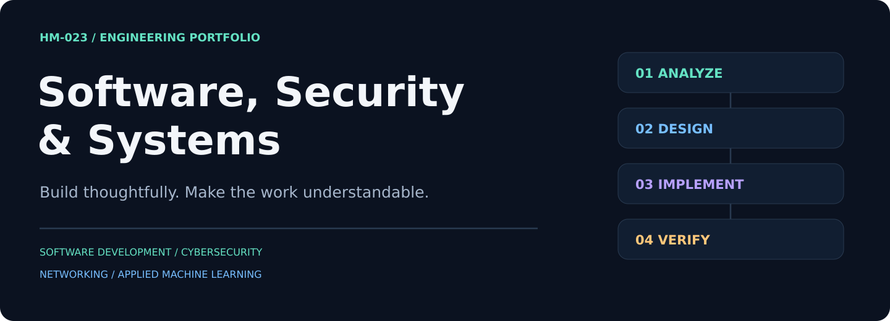
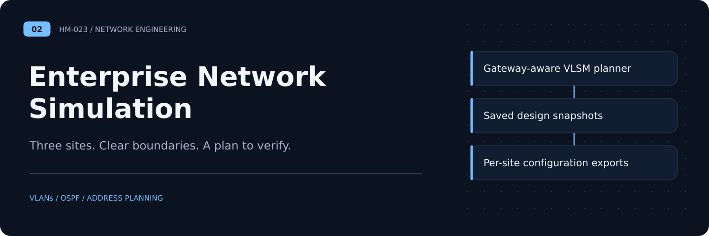
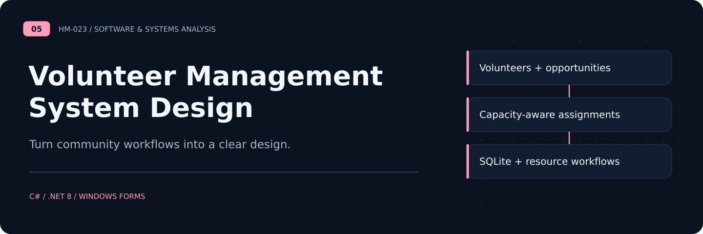

# Building software. Understanding systems.

I build local software tools and explore how networks and security controls fit together. My work connects implementation with architecture, clear documentation and reproducible checks.

**Software Development · Cybersecurity · Networking · Applied Machine Learning**

[Explore repositories](https://github.com/HM-023?tab=repositories) · [Engineering approach](#how-i-work)

## Selected Work

Five runnable local workspaces spanning applied ML, network engineering, defensive security and community operations. Each repository includes a dashboard, persistence, meaningful regression checks and an automated browser journey.

| | |
|:---|:---|
|  **[Network Threat Detection](https://github.com/HM-023/NetworkThreatDetection)** A local ML studio with dataset inspection, three holdout strategies, saved-model prediction and reproducible experiment history.  **Local ML workspace** |  **[Enterprise Network Simulation](https://github.com/HM-023/EnterpriseNetworkSimulation)** A working VLSM design planner with gateway-aware allocation, saved designs and per-site configuration exports.  **Local network planner** |

| | |
|:---|:---|
|  **[Defense in Depth Architecture](https://github.com/HM-023/DefenseInDepthArchitecture)** A first-match policy analyzer with access matrices, shadowing warnings and executable allow/deny assertions, plus an EVE-NG reference layout.  **Local policy analyzer** |  **[Authorized Security Assessment Lab](https://github.com/HM-023/AuthorizedSecurityAssessmentLab)** A persistent assessment workspace with finding lifecycles, retest notes and redacted Markdown/HTML report exports.  **Local assessment workspace** |

### [Volunteer Management System Design](https://github.com/HM-023/VolunteerManagementSystemDesign)

A persistent community operations app with skills-based matching, capacity checks, same-day conflict protection and resource-intent tracking. The earlier C# prototype remains available.

**Python · SQLite · Browser UI · C# reference prototype**

## Tools in Context

| Area | Tools and methods used in these projects |
|:---|:---|
| Applied ML | Python, pandas, NumPy, scikit-learn, stratified evaluation |
| Software | Python, SQLite, JavaScript, responsive browser interfaces; C#/.NET prototype |
| Networking | VLANs, OSPF, address planning, Cisco-style configuration examples |
| Security | Threat modeling, segmentation, assessment reporting, remediation |
| Engineering | GitHub Actions, domain regression tests, Playwright browser journeys |

## How I Work

- **Start with the problem.** Make requirements and boundaries clear before choosing tools.
- **Make it reproducible.** Include setup steps, small examples and useful verification checks.
- **Show the evidence.** Distinguish working code, proposed architecture and observed results.
- **Respect the source material.** Keep private data and restricted historical artifacts out of public repositories.

The workspaces are local, single-user tools with explicit scope. ML evaluation does not imply real-traffic accuracy, and design/policy outputs do not imply live network enforcement. Project READMEs document those boundaries.
