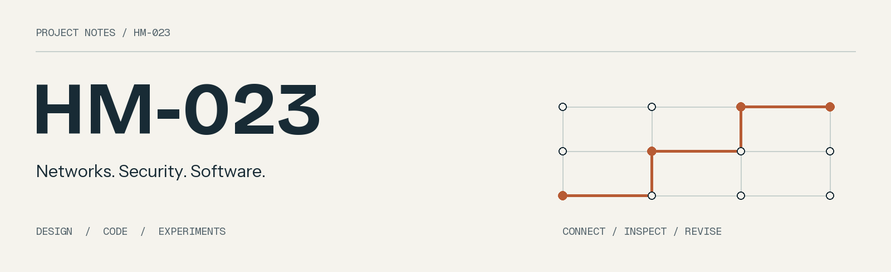

A collection of network designs, security labs and small applications. Each project links to its code, design decisions and the checks that can be repeated.

### Network traffic classification
**Python · pandas · scikit-learn**

[Network Threat Detection](https://github.com/HM-023/NetworkThreatDetection) — classify labeled flow records and examine per-class errors. The key question is how the choice of holdout changes what an evaluation can tell us.

[Training code](https://github.com/HM-023/NetworkThreatDetection/blob/main/src/train.py) · [Evaluation method](https://github.com/HM-023/NetworkThreatDetection/blob/main/docs/evaluation.md)

### Three-site network design
**VLANs · VLSM · OSPF · Packet Tracer design**

[Enterprise Network Simulation](https://github.com/HM-023/EnterpriseNetworkSimulation) — plan segmentation and addressing for a headquarters and two branches. Includes configuration examples and a later Python subnet planner; simulator execution is still unverified.

[Addressing example](https://github.com/HM-023/EnterpriseNetworkSimulation/blob/main/docs/address-plan.md) · [Connectivity checklist](https://github.com/HM-023/EnterpriseNetworkSimulation/blob/main/docs/verification-plan.md)

### Layered network security
**Security zones · EVE-NG reference layout · Policy tests**

[Defense in Depth Architecture](https://github.com/HM-023/DefenseInDepthArchitecture) — connect a segmented design to explicit allow/deny expectations. The policy analyzer checks logical rules; the 11-node layout is a separate lab reference.

[Control matrix](https://github.com/HM-023/DefenseInDepthArchitecture/blob/main/docs/security-controls.md) · [Example policy](https://github.com/HM-023/DefenseInDepthArchitecture/blob/main/examples/workspace-policy.json)

### Volunteer coordination
**Systems analysis · C# / Windows Forms · Python · SQLite**

[Volunteer Management System Design](https://github.com/HM-023/VolunteerManagementSystemDesign) — requirements and use cases, a small Windows prototype, and a later local app for scheduling volunteers and tracking resource pledges.

[Requirements](https://github.com/HM-023/VolunteerManagementSystemDesign/blob/main/docs/requirements.md) · [C# prototype](https://github.com/HM-023/VolunteerManagementSystemDesign/tree/main/prototype)

### Assessment findings and remediation
**Security assessment · Reporting · Retesting**

[Authorized Security Assessment Lab](https://github.com/HM-023/AuthorizedSecurityAssessmentLab) — a sanitized methodology case study and a local findings register. Covers how an observation becomes a documented fix and a retest, with fictional examples.

[Finding categories](https://github.com/HM-023/AuthorizedSecurityAssessmentLab/blob/main/docs/findings.md) · [Report template](https://github.com/HM-023/AuthorizedSecurityAssessmentLab/blob/main/templates/finding-template.md)

---

Original work included collaboration. Public repositories use generic examples and separate historical designs from later software extensions. Personal details, source reports and private evidence are excluded.
